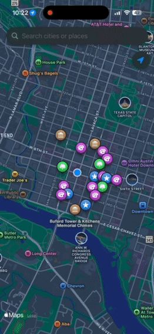

# World Guide

World Guide is an iOS app that turns the map around you into a personal tour guide. It shows the
landmarks, museums, parks and historic places nearby, and when you tap one it writes a fun,
accurate guide to it: a summary, history, stories, fun facts, photos and visiting tips. Every guide
can be read aloud with natural AI narration, so you can listen while you walk. You can also get
walking, driving or transit directions and save places to your own lists.

<p align="center">
  
</p>

---

## How it works

The app is SwiftUI on the front end and Firebase (Cloud Functions in TypeScript, Firestore and
Cloud Storage) on the back end. The phone never holds the OpenAI or ElevenLabs keys: it asks the
backend for a guide, and the backend does all the paid AI work and caches the result.

```
iPhone (SwiftUI + MapKit)
  ├─ Google Places API ........ nearby places and search
  ├─ Apple MapKit ............. map, walk/drive routes, search suggestions
  ├─ Google Routes API ........ transit routes
  └─ Firebase Cloud Function .. "give me the guide for this place"
        ├─ Firestore cache hit? → return it instantly
        └─ miss:
             1. Google Places → review count → pick quality tier
             2. Wikipedia → reference facts
             3. OpenAI GPT-4o → writes the guide (streamed to the phone)
             4. Wikimedia Commons → real photos
             5. OpenAI TTS or ElevenLabs → narration MP3 → Cloud Storage
             6. save everything to Firestore for the next visitor
```

### AI-written place descriptions

Guides are written by **OpenAI GPT-4o** (`functions/src/index.ts`, prompt in
`functions/src/prompt.ts`).

- **Grounded in Wikipedia.** Before calling the model, the backend looks for the place's
  Wikipedia article (`functions/src/wikipedia.ts`). It first searches for articles within 1 km
  of the place's coordinates, then falls back to a name search, and only accepts an article
  whose title actually matches the place name, so an unnamed café isn't described using a
  nearby landmark's article. The article's intro is passed to the model as reference material
  it must not contradict.
- **Structured output.** The model returns JSON (OpenAI JSON mode) with a summary, a spoken
  intro, and optional sections (history, stories, fun facts, details, significance, visiting
  tips), plus a confidence level and search phrases for photos. The prompt tells it to leave
  out any section it can't fill with real, interesting content, so a coffee shop gets a short
  guide and the Eiffel Tower gets a long one.
- **Tone control.** The model picks a tone per place: playful by default, neutral where humor
  would feel forced, and respectful (no jokes) for memorials, religious sites and places of
  tragedy.
- **Streamed to the phone.** The `streamPlaceContent` endpoint streams the model's output over
  Server-Sent Events. The backend parses the partial JSON as it arrives, so the summary shows up
  in about two to three seconds and the other sections fill in while the rest is still being
  written.
- **Generated once, then cached.** The finished guide (with photos, audio link, model name and
  prompt version) is stored in Firestore under the Google place ID. The next person to open that
  place gets it from the cache with no AI calls at all.

### How Google reviews are used

The app does not read or summarize review text. The backend asks the Google Places API for one
field, the place's **review count** (`userRatingCount`, in `functions/src/placeDetails.ts`), and
uses it as a popularity signal:

- **More than 10,000 reviews → premium tier** (famous places, narrated with ElevenLabs).
- **Otherwise → standard tier** (narrated with OpenAI TTS).

The count is only used for that decision and is never saved, in line with Google's caching terms.

### Narration: ElevenLabs and OpenAI voices

The whole guide is narrated, not just the intro (`functions/src/tts.ts`). The backend turns the
guide into a listening script ("A bit of history…", "Here are some fun facts…", and so on),
splits it into chunks at sentence boundaries to stay under the speech APIs' length limits, and
joins the resulting MP3s into one file.

| Tier | Places | Voice |
|---|---|---|
| Premium | Popular places (over 10,000 Google reviews) | **ElevenLabs** `eleven_multilingual_v2`, "Rachel" voice |
| Standard | Everything else | **OpenAI TTS** `tts-1-hd`, "nova" voice |

The MP3 is saved to Firebase Cloud Storage (`audio/{place_id}.mp3`), so each place is only ever
narrated once. On the phone, the app downloads and plays that file. If there's no audio (offline,
or generation failed) it falls back to Apple's built-in on-device voice.

### Photos

Along with the guide, the model suggests a few photo search phrases. The backend searches
**Wikimedia Commons** with them (`functions/src/photos.ts`) and keeps up to four real, licensed
photos, each shown with its author and license. The model is told never to make up image URLs.

### Accounts, limits and data

- **Firebase Authentication.** Every user gets an anonymous account on first launch and can
  upgrade it with Sign in with Apple or email and password. Every request to the backend carries
  a Firebase ID token.
- **Firebase App Check** (App Attest on device) is wired up and currently runs in monitor mode.
- **Usage limits** (`functions/src/metering.ts`) are enforced on the server in Firestore
  transactions: a free trial of 5 active days, a rate limiter for everyone, and a daily cap on new
  guide generations to bound API cost.
- **Saved lists** sync through Firestore (`users/{uid}/lists`). Security rules let a user touch
  only their own lists; the places cache and usage records can only be written by the backend.
- **Account deletion** is supported in the app and wipes the user's data through the
  `deleteUserData` function.
- **Subscriptions:** RevenueCat purchase code and a webhook (`functions/src/revenuecat.ts`) are
  written, but RevenueCat is not set up yet, so in-app purchases are currently turned off.

### External APIs

**Called from the iOS app**

| API | Used for |
|---|---|
| Google Places API (New): `searchNearby` | Tour-worthy places around you (landmarks, museums, parks, places of worship and more) |
| Google Places API (New): `searchText` | The search bar (cities or specific places) |
| Google Routes API: `computeRoutes` | Transit directions and the route line on the map |
| Apple MapKit: `MKDirections` | Walking and driving directions |
| Apple MapKit: `MKLocalSearchCompleter` | Search suggestions as you type |
| Apple Core Location | Your position on the map |
| Apple AVSpeechSynthesizer | Offline fallback narration |
| Firebase Auth, Firestore, App Check | Sign-in, saved lists, request verification |
| World Guide backend (Cloud Functions) | `streamPlaceContent`, `getPlaceContent`, `deleteUserData` |

**Called from the Firebase backend**

| API | Used for |
|---|---|
| OpenAI Chat Completions (GPT-4o) | Writing the guide |
| OpenAI Audio Speech (`tts-1-hd`) | Standard-tier narration |
| ElevenLabs Text-to-Speech | Premium-tier narration |
| Google Places API (New): Place Details | Review count for choosing the tier |
| Wikipedia (MediaWiki API + REST summary) | Fact grounding |
| Wikimedia Commons API | Photos with attribution and license |
| Firebase Firestore, Cloud Storage, Auth, App Check (Admin SDK) | Cache, audio files, verifying requests, usage limits |

### API keys

No API keys are in this repository. The OpenAI, ElevenLabs and server-side Google keys are
Firebase Functions secrets (Google Cloud Secret Manager) and never reach the phone. The
on-device Google key and the function URLs live in `Secrets.swift`, which is gitignored; copy
`ios-src/Secrets.example.swift` to get started.

## Repository layout

```
ios-src/        SwiftUI source (Models, Services, ViewModels, Views)
WorldGuide/     Xcode project (synced from ios-src/ by scripts/install-ios-files.sh)
functions/      Firebase Cloud Functions (TypeScript)
prompts/        The guide-writing prompt contract
docs/           Demo GIF
```

See [SETUP.md](SETUP.md) to run it yourself and [ARCHITECTURE.md](ARCHITECTURE.md) for a deeper
system map.
